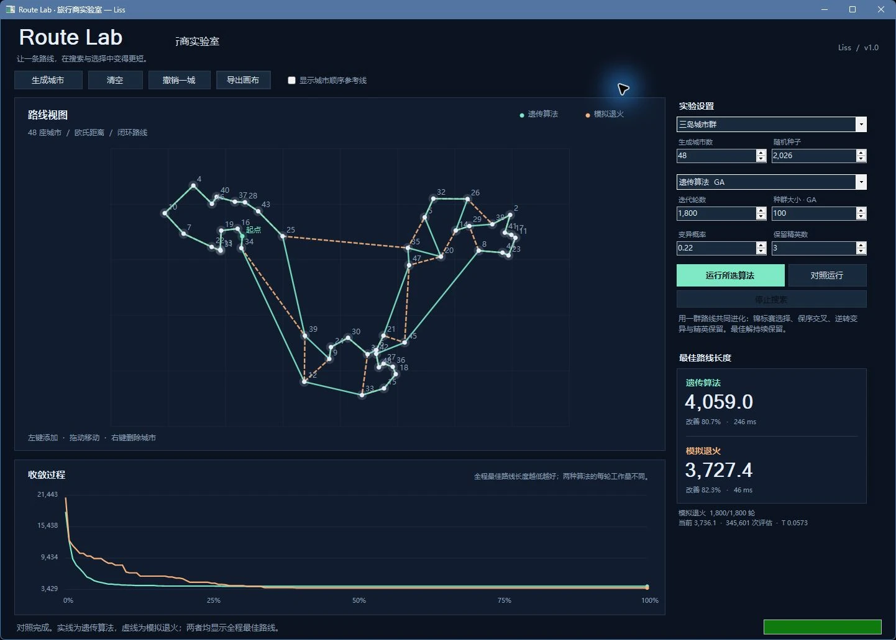

# Route Lab · 旅行商实验室

Liss 的桌面算法实验工具。给同一组城市，分别用**遗传算法**和**模拟退火**寻找更短的闭环路线，观察实际搜索过程、参数与收敛曲线。

从 2016 年的 WinForms 旅行商程序恢复、整理而来。历史源码保存在 `legacy/`，现代实现位于 `src/`；二者明确区分。没有第三方算法包，也不宣称启发式算法能保证全局最优。

[作品介绍与更多画面](https://heroliss.github.io/liss-works/projects/route-lab/) · [最新 Windows 发行版](https://github.com/heroliss/route-lab/releases/latest)



## 体验

Windows 10 / 11 x64：解压发布包并运行 `RouteLab.exe`。自包含发布包已带 .NET 运行环境，无需另外安装 SDK。

1. 选择三岛城市群、环形或随机散点，设置数量与随机种子，点击“生成城市”。
2. 左键添加城市，拖动移动，右键删除。第一座城市为固定起点。
3. 选择算法与参数，点击“运行所选算法”或“对照运行”。
4. 观察彩色路线、实际收敛曲线、最佳长度与耗时。停止会保留已找到的最佳路线。
5. 可以导出当前画布为 PNG。`F5` 运行，`Shift + F5` 对照，`Esc` 停止。

实线为遗传算法，虚线为模拟退火。曲线显示全程最佳值；侧栏“当前”指标仍允许呈现退火暂时接受的较差解。两种算法每轮工作量不同，比较结果会列出评估数和实际耗时，不将轮数直接当成等量计算预算。

## 可重复样例

下面的命令会真实生成城市并运行算法，没有预制结果或伪造的曲线数据：

```powershell
.\RouteLab.exe --sample archipelago --seed 2026 --cities 48 --compare --size 1440x1000
.\RouteLab.exe --sample ring --seed 42 --cities 32 --algorithm sa --autorun
.\RouteLab.exe --sample random --seed 825 --cities 72 --iterations 2400 --population 120 --compare
```

`--sample` 可选 `archipelago`、`ring`、`random`。固定城市、选项、算法和种子会得到相同路线（运行耗时不固定）。编辑城市后，旧曲线和结果自动清除。

## 技术与修复

- **遗传算法**：锦标赛选择、保序交叉、路线区间逆转变异、精英保留。每代都保持合法排列，从实际第一代中选出最佳解，避免旧实现的未初始化个体和负适应度问题。
- **模拟退火**：2-opt 逆转候选，利用对称距离矩阵以 O(1) 计算候选成本变化；接受后才修改路线，拒绝不会污染当前状态，另外保存全程最佳。接受后重算完整长度以避免浮点误差累积。
- **运行隔离**：纯 .NET 算法内核与 WinForms 分开；UI 仅在主线程更新。后台发送各自拥有数组的进度快照，停止通过 CancellationToken 协作取消。
- **可视化**：双缓冲路线画布与收敛曲线，CJK 系统字体，深色高对比配色，同屏呈现城市、算法参数与真实运行指标。支持 3—200 座城市。
- **验证**：16 项无外部测试框架的控制台回归，覆盖已知正方形最优值、合法排列、精确路线成本、全程最佳不退化、固定种子、取消、三城/重合/200 城边界、退火拒绝与逆转增量。

## 开发与发布

需要 .NET 10 SDK；界面构建与运行需要 Windows。

```powershell
dotnet build RouteLab.slnx -c Release
dotnet run --project tests/RouteLab.Regression -c Release -- --report verification/algorithm-regression.json
dotnet run --project src/RouteLab.App -c Release -- --compare
pwsh -File scripts/publish-windows.ps1
```

发布脚本先运行回归，再生成 `artifacts/RouteLab-1.0.0-win-x64.zip` 并输出 SHA-256。不使用需要旧 .NET Framework 或旧 Qt 的环境。

自包含包随附 `licenses/` 中的 .NET Runtime、WinForms 许可与第三方声明；这些声明仅对应平台依赖，不为本项目额外授予开源许可。

## 来源

原始位置：个人“自写程序备份”中的 `2016年/旅行商问题`。`legacy/source-manifest.json` 记录复制的源文件及 SHA-256；未包含旧二进制、缓存、个人数据库、用户设置或凭据。`legacy/` 仅作历史追溯，不参与现代方案编译。
